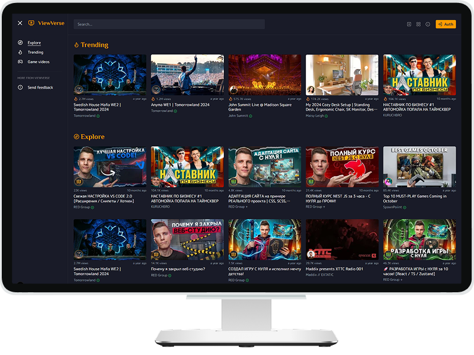

# Project name: ViewVerse

### 💎 Description

[](preview.png)

"ViewVerse" is a video platform similar to YouTube, built with **Next.js v15**, **React v19**,
**TypeScript** and **Tailwind**.

It provides a modern, responsive interface for browsing, watching, and engaging with video content,
showcasing a scalable and feature-rich web application.

The focus of the online-course was on frontend development — the backend came pre-built.

### 🧩 Tech Stack

**Framework**


**State & Data**


**UI & Animations**


**Forms & UX**


**Utilities**


**Styling**


<!-- end:tech-stack -->

**Infrastructure**


---

### Start

First, install and run the development server:

```bash
powershell -c "irm bun.sh/install.ps1|iex"
bun dev
```

<details style="border:1px solid #d4d4d4; border-radius:2px; padding:1rem;">
<summary><h4 style="display:inline; padding-left:6px;">🗃 Dependencies</h4></summary>

```bash
bun add sass
bun add -D @trivago/prettier-plugin-sort-imports prettier
bun add lucide-react
bun add clsx
bun add path-to-regexp
bun add axios
bun add @tanstack/react-query
bun add dayjs
bun add tailwind-merge
bun add framer-motion
bun add react-hook-form
bun add js-cookie
bun add -D @types/js-cookie
bun add react-google-recaptcha
bun add -D @types/react-google-recaptcha
bun add react-hot-toast
bun add @reduxjs/toolkit react-redux
bun add jose
bun add html-react-parser
bun add react-hotkeys-hook
bun add rc-slider
bun add rc-tooltip
bun add linkify-html
bun add next-sitemap

# bundle analyzer
npm install --save-dev @next/bundle-analyzer
npm install --save-dev cross-env
```

</details>

---

### 📋 TODO:

- [ ] переместить НЕ ПОДТВЕРЖДЕНО в оповещения, а также отображать сообщение в userSettings

  ### Design:

- [ ] button colors
- [ ] @media:
  - [ ] video player styles
  - [ ] images
  - [ ] grid
- [ ] media query:sideBar на мобилах изначально скрыт, при открытии - поверх контента
- [ ] ? replace Skeleton on Dynamic pages to <Loading /> or review style code (cols)
- [ ] UI block's heading/loader

  - [x] heading
  - [ ] SkeletonLoader: - [x] static count - [ ] count depends on @media

  ### New/Server functions:

- [ ] ? found videos with user's comment
- [ ] ? password reset option
- [ ] [!] change domain for production
- [ ] SERVER: у "новых" пользователей нет channelId и не могут заливать видео
- [ ] SERVER: имя файла банера/аватара на сервере должно совпадать с пользователем/каналом
- [ ] SERVER: имя файла привью на сервере должно совпадать с именем файла видео Нужно сообщение
      пользователю
- [ ] SERVER: после обработки, удалить файл видео из общей папки загрузки
- [ ] SERVER: после удаления видео из БД, файлы остаются на сервере (видео во всех папках + привью)
- [ ] SERVER: картинки (аватар,банер,превью), которые не используются/заменяются остаются на
      сервере!!!

<!-- - [ ] меню кнопка?, 1 колонка
- [ ] xs 540 - меню скрыто, 2 колонки
- [ ] sm 640
- [ ] md 768 - меню скрыто, 3 колонки
- [ ] lg 1024 - меню открыто, 3 колонки
- [ ] xl 1280 - меню открыто, 4 колонки
- [ ] 2xl 1536  -->

<details style="border:1px solid #d4d4d4; border-radius:2px; padding:1rem;">
<summary><h4 style="display:inline; padding-left:6px;">✅ Done</h4></summary>

- [x] root layout
- [x] UI menu/nav/sidebar
- [x] metadata
- [x] UI video card
- [x] fonts (b.a VideoCard title)
- [x] Home page (ISR):
  - [x] trending videos
  - [x] explore(recommended) videos
- [x] Search
- [x] сократить название канала, если слишком длинное
- [x] Page 404
- [x] game videos
- [x] VideoCard animations
- [x] UI field, button
- [x] UI login/registration form
- [x] Integrate recaptcha
- [x] log out button
- [x] user's avatar (channel avatar || default)
- [x] email confirmation
- [x] axios interceptors
- [x] test tokens
- [x] Middleware / verify token
- [x] FIX! redirect after logout(special on pages with auth)
- [x] Profile settings
  - [x] UI form
  - [x] functions: update text fields, upload avatar/header
- [x] channel page:
  - [x] subscribe button
  - [x] banner
  - [x] section my subscriptions
- [x] [FIXME] SUBSCRIPTIONS/STUDIO linkS do not see/remember isShowedSidebar
- [x] videoPage:
  - [x] similar videos block
  - [x] collapse description of video
  - [x] styling
  - [x] comments:
    - [x] display comments
    - [x] form to add comment
    - [x] actions: edit/delete !only own comments
  - [x] player:
    - [x] current time
    - [x] make progress bar clickable
    - [x] video may not have quality options
    - [x] volume button
    - [x] implement theater mode
    - [x] style @media: when side bar is open/collapsed in theater mode
    - [x] [FIXME] not valid video duration on first loading
    - [x] [FIXME] btn pause does not changes to play at the end of video
- [x] sort/group videos on SubscriptionsPage
- [x] btn delete video from liked list
- [x] btn delete video from history list
- [x] FIXME logout on ChannelPage, History, Liked videos, Subscriptions, Playlists (should redirect
      to home/auth)
- [x] playlists:
  - [x] btn add to playList
  - [x] modal form, messages
  - [x] playlist page
  - [x] delete/toggle video from list
  - [x] rename playlist
  - [x] delete playlist
- [x] Subscribe btn should be disabled if channel owner
- [x] views updating (on refresh/play?)
- [x] history updating (on play?)
- [x] disable like and views updating for video owner
- [x] message if video not found
- [x] page with a list of user's videos
- [x] pagination
- [x] delete video functional
- [x] обработать описание видео (теги и перенос строк)
- [x] ? crop images (thumbnail)
- [x] metadata, SEO
- [x] skeleton for player
- [x] вспомогательный текст загрузки картинок и видео (формат,размер,вес). Аватар, баннер,
- [x] после редактирования профиля, нужно сообщение об успехе
- [x] доработать загрузку плеера на VideoPlayer
- [x] TODO default banner
- [x] безопасная обработка тегов в комментах
- [x] если видео неподходящего разрешения/формата, оно загружается на сервер и фейково
      "обрабатывается". привью есть, но видео на сервере только в первоначальной папке. Сообщение
      пользователю о неподходящем разрешении.
- [x] разделить settings на пользовательские и для канала
- [x] после регистрации перенаправлять на userSettings
- [x] если пользователь не подтвердил регистрацию, скрывать студию

</details>

---

> [!NOTE] To use rc-slider and rc-tooltip as native input see lesson 40 / branch inputSlider
